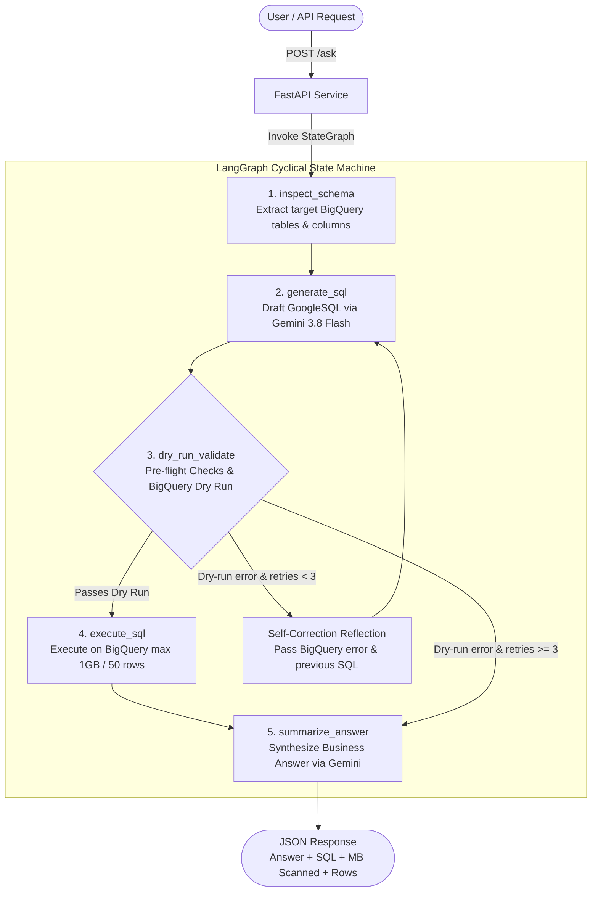

# Self-Correcting Text-to-SQL Data Analyst Agent

[](https://www.python.org/downloads/)
[](https://fastapi.tiangolo.com)
[](https://github.com/langchain-ai/langgraph)
[](https://ai.google.dev/)
[](https://cloud.google.com/bigquery)
[](https://cloud.google.com/run)

A production-ready **Self-Correcting Text-to-SQL Data Analyst Agent** built with **LangGraph**, **Google Gemini 3.8 Flash** (`langchain-google-genai`), **Google BigQuery**, and **FastAPI**, containerized for **Google Cloud Run**.

The agent translates natural language business questions into optimized BigQuery GoogleSQL queries, runs them against zero-cost dry runs with strict cost and safety guardrails, self-corrects any SQL or schema errors automatically via an iterative reflection loop, and synthesizes clear, stakeholder-ready natural language insights.

---

## Architecture & Workflow

The agent uses a **LangGraph `StateGraph`** state machine to orchestrate schema extraction, query drafting, dry-run validation, self-correction, execution, and summarization:



---

## Key Features

- **Schema-Aware Query Generation**: Automatically inspects table and column schemas in BigQuery (defaulting to `bigquery-public-data.thelook_ecommerce`) to produce accurate GoogleSQL without hallucinations.
- **Autonomous Self-Correction Loop**: When BigQuery dry-run detects a syntax error, unknown column, or invalid join, the agent captures the exact compiler message and prompts Gemini to fix its own mistake (up to 3 retries).
- **Safety & Mutation Blocking**: Pre-execution regex analysis immediately rejects any destructive DDL/DML statements (`DROP`, `DELETE`, `UPDATE`, `INSERT`, `TRUNCATE`, `ALTER`, `MERGE`). Only `SELECT` queries are permitted.
- **Cost & Quota Protection**: Executes zero-cost dry runs (`bigquery.QueryJobConfig(dry_run=True)`) to verify syntax and estimate data scanned. Rejects queries that would process more than **1 GB** (1,073,741,824 bytes).
- **Production API Layer**: Modern FastAPI application providing health checking (`/health`) and structured query endpoints (`/ask`).
- **Cloud Run Ready**: Containerized with a slim Docker image adhering to Google Cloud Run conventions (dynamic `${PORT}` injection, non-root user friendly, fast startup).

---

## Project Structure

```text
bq-sql-agent/
├── app/
│   ├── __init__.py
│   ├── state.py         # SQLAgentState TypedDict
│   ├── bq_tools.py      # BigQuery schema inspection, dry-run validation, safe execution
│   ├── agent.py         # LangGraph StateGraph & Gemini 3.8 Flash self-correcting loop
│   └── main.py          # FastAPI application (GET /health, POST /ask)
├── tests/
│   ├── __init__.py
│   └── test_guardrails.py # 14 unit tests covering mutations, byte caps, and retry loops
├── Dockerfile           # Python 3.11 slim Docker container for Cloud Run
├── .dockerignore        # Docker build ignore patterns
├── .gitignore           # Git ignore patterns (ensures .env and secrets are never committed)
├── .env.example         # Template for environment configuration
├── pytest.ini           # Pytest configuration
├── test_local.py        # Local CLI script verifying live BigQuery integration
└── README.md            # Comprehensive project documentation
```

---

## Prerequisites

1. **Python 3.11+** installed on your machine.
2. **Google Gemini API Key**: Get a key from [Google AI Studio](https://aistudio.google.com/).
3. **Google Cloud Account**: A project with the **BigQuery API** enabled.
4. **Google Cloud SDK (`gcloud`)**: Authenticated with Application Default Credentials (ADC).

---

## Quickstart & Setup

### 1. Clone the Repository
```bash
git clone https://github.com/<your-username>/bq-sql-agent.git
cd bq-sql-agent
```

### 2. Create and Activate a Virtual Environment
```bash
# On Linux / macOS
python3 -m venv .venv
source .venv/bin/activate

# On Windows (PowerShell)
python -m venv .venv
.\.venv\Scripts\Activate.ps1
```

### 3. Install Dependencies
```bash
pip install --upgrade pip
pip install -r requirements.txt
```

### 4. Configure Environment Variables
Copy `.env.example` to `.env`:
```bash
cp .env.example .env
```
Edit `.env` with your credentials:
```env
# Gemini API Key (do not use Vertex AI)
GOOGLE_API_KEY=your_gemini_api_key_here

# Google Cloud Project ID used for BigQuery query billing
GOOGLE_CLOUD_PROJECT=your_gcp_project_id_here
```

### 5. Authenticate Google Cloud ADC
Authenticate your local environment to allow the BigQuery client to run queries:
```bash
gcloud auth application-default login
gcloud auth application-default set-quota-project your_gcp_project_id_here
```

---

## Running Locally

### CLI Verification (`test_local.py`)
Run the end-to-end integration test querying the public `thelook_ecommerce` dataset:
```bash
python test_local.py
```

**Sample Output:**
```text
======================================================================
Running Self-Correcting BigQuery SQL Agent Local Test
======================================================================
[INFO] Target Dataset: bigquery-public-data.thelook_ecommerce
[INFO] Target Project: bq-sql-514913

[QUERY QUESTION]:
What are the top 5 product categories by total revenue for completed orders?

[INFO] Invoking LangGraph SQL Agent...

======================================================================
AGENT EXECUTION RESULTS
======================================================================
Attempts: 1
Estimated MB Scanned: 5.1076 MB (5355743 bytes)

Generated SQL:
----------------------------------------
SELECT
    p.category,
    SUM(oi.sale_price) AS total_revenue
FROM
    `bigquery-public-data.thelook_ecommerce.order_items` AS oi
JOIN
    `bigquery-public-data.thelook_ecommerce.products` AS p
    ON oi.product_id = p.id
WHERE
    oi.status = 'Complete'
GROUP BY
    p.category
ORDER BY
    total_revenue DESC
LIMIT 5
----------------------------------------

Retrieved Rows (5):
[
  {"category": "Outerwear & Coats", "total_revenue": 346003.41},
  {"category": "Jeans", "total_revenue": 318842.65},
  {"category": "Sweaters", "total_revenue": 206136.27},
  {"category": "Fashion Hoodies & Sweatshirts", "total_revenue": 166577.30},
  {"category": "Swim", "total_revenue": 162552.83}
]

Final Answer:
----------------------------------------
The top 5 product categories by total revenue for completed orders are:

1. Outerwear & Coats: $346,003.41
2. Jeans: $318,842.65
3. Sweaters: $206,136.27
4. Fashion Hoodies & Sweatshirts: $166,577.30
5. Swim: $162,552.83
----------------------------------------
```

### Starting the FastAPI Server
```bash
uvicorn app.main:app --host 0.0.0.0 --port 8080 --reload
```
Interactive Swagger API documentation is accessible at `http://localhost:8080/docs`.

---

## API Reference

### 1. Health Check
- **Endpoint**: `GET /health`
- **Response**:
```json
{
  "status": "healthy"
}
```

### 2. Ask Natural Language Question
- **Endpoint**: `POST /ask`
- **Request Body**:
```json
{
  "question": "What are the top 5 product categories by total revenue for completed orders?",
  "dataset_id": "bigquery-public-data.thelook_ecommerce"
}
```
- **Response**:
```json
{
  "answer": "The top 5 product categories by total revenue for completed orders are Outerwear & Coats ($346,003.41), Jeans ($318,842.65), Sweaters ($206,136.27), Fashion Hoodies & Sweatshirts ($166,577.30), and Swim ($162,552.83).",
  "sql": "SELECT p.category, SUM(oi.sale_price) AS total_revenue FROM `bigquery-public-data.thelook_ecommerce.order_items` AS oi JOIN `bigquery-public-data.thelook_ecommerce.products` AS p ON oi.product_id = p.id WHERE oi.status = 'Complete' GROUP BY p.category ORDER BY total_revenue DESC LIMIT 5",
  "attempts": 1,
  "estimated_mb_scanned": 5.1076,
  "rows": [
    {
      "category": "Outerwear & Coats",
      "total_revenue": 346003.4096431732
    },
    {
      "category": "Jeans",
      "total_revenue": 318842.65046310425
    },
    {
      "category": "Sweaters",
      "total_revenue": 206136.26995754242
    },
    {
      "category": "Fashion Hoodies & Sweatshirts",
      "total_revenue": 166577.30014896393
    },
    {
      "category": "Swim",
      "total_revenue": 162552.83025932312
    }
  ]
}
```

---

## Running Automated Tests

Run the unit test suite to verify guardrails, mutation blocking, byte scan limits, and LangGraph routing:
```bash
pytest
```
**Test Results:**
```text
tests/test_guardrails.py::TestSQLGuardrails::test_mutating_sql_blocked_immediately[DROP] PASSED
tests/test_guardrails.py::TestSQLGuardrails::test_mutating_sql_blocked_immediately[DELETE] PASSED
tests/test_guardrails.py::TestSQLGuardrails::test_mutating_sql_blocked_immediately[UPDATE] PASSED
tests/test_guardrails.py::TestSQLGuardrails::test_mutating_sql_blocked_immediately[INSERT] PASSED
tests/test_guardrails.py::TestSQLGuardrails::test_mutating_sql_blocked_immediately[TRUNCATE] PASSED
tests/test_guardrails.py::TestSQLGuardrails::test_mutating_sql_blocked_immediately[ALTER] PASSED
tests/test_guardrails.py::TestSQLGuardrails::test_mutating_sql_blocked_immediately[MERGE] PASSED
tests/test_guardrails.py::TestSQLGuardrails::test_bytes_exceeded_fails_validation PASSED
tests/test_guardrails.py::TestSQLGuardrails::test_valid_dry_run_passes PASSED
tests/test_guardrails.py::TestLangGraphRoutingAndLoop::test_route_to_execute_sql_when_valid PASSED
tests/test_guardrails.py::TestLangGraphRoutingAndLoop::test_route_to_generate_sql_when_retry_less_than_3 PASSED
tests/test_guardrails.py::TestLangGraphRoutingAndLoop::test_route_to_summarize_answer_when_retry_3_or_more PASSED
tests/test_guardrails.py::TestLangGraphRoutingAndLoop::test_end_to_end_graph_successful_path PASSED
tests/test_guardrails.py::TestLangGraphRoutingAndLoop::test_self_correction_retry_loop_recovers PASSED

======================= 14 passed in 1.73s =======================
```

---

## Deployment to Google Cloud Run

### 1. Build and Deploy Using Google Cloud Build & Cloud Run
```bash
# Set your project
gcloud config set project your_gcp_project_id_here

# Build image and submit to Google Container/Artifact Registry
gcloud builds submit --tag gcr.io/your_gcp_project_id_here/bq-sql-agent

# Deploy to Cloud Run
gcloud run deploy bq-sql-agent \
  --image gcr.io/your_gcp_project_id_here/bq-sql-agent \
  --platform managed \
  --region us-central1 \
  --allow-unauthenticated \
  --set-env-vars GOOGLE_API_KEY=your_gemini_api_key_here,GOOGLE_CLOUD_PROJECT=your_gcp_project_id_here
```

### 2. Local Docker Execution
```bash
# Build Docker image
docker build -t bq-sql-agent:latest .

# Run container locally
docker run -p 8080:8080 \
  --env-file .env \
  bq-sql-agent:latest
```

---

## License

This project is open-source and available under the [MIT License](LICENSE).
